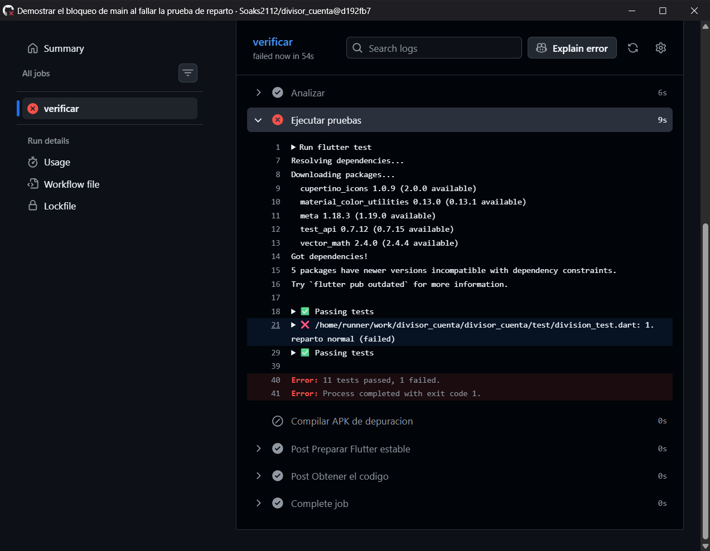
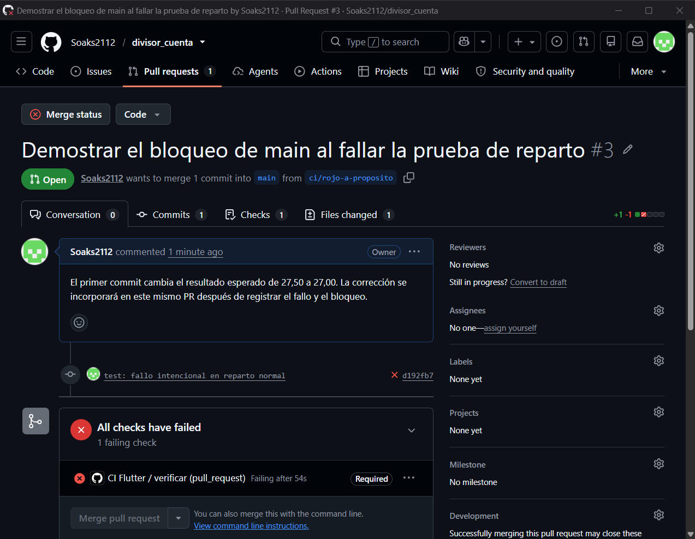
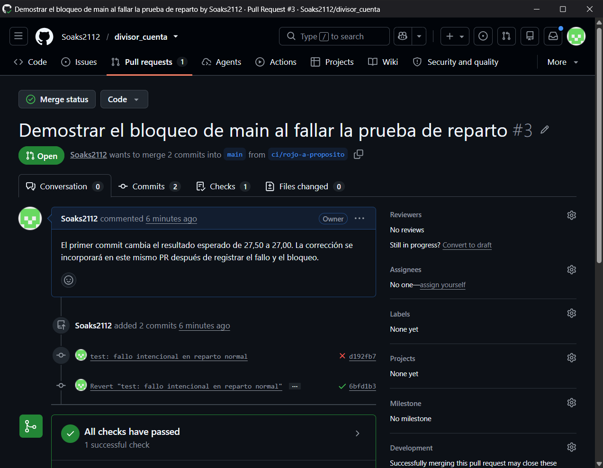
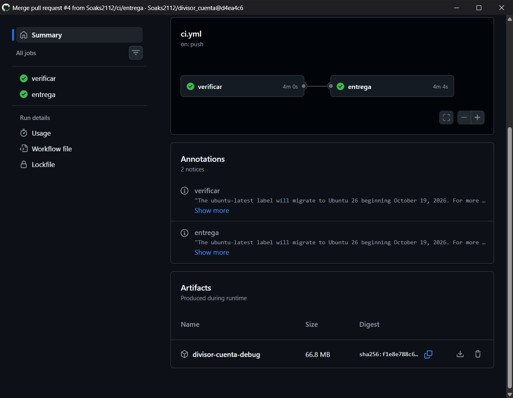

# Deber 4 · Verificación y entrega del divisor de cuenta

## 1. ¿Qué hace el workflow?

- **Analyze** revisa el código Dart con las reglas del proyecto y señala errores de tipos y avisos.
- **Test** ejecuta las pruebas del reparto, las validaciones y la pantalla.
- **Build** compila la aplicación Android en modo depuración y genera `app-debug.apk`.

En cada PR y en cada push a `main`, el primer job descarga el código, prepara Flutter estable e instala las dependencias. En un push a `main`, si ese job pasa, `entrega` prepara otra máquina, recompila el mismo commit y sube el APK. [Workflow](.github/workflows/ci.yml) · [Primer CI verde](evidencias/parte1_ci_verde.png) · [PR del CI](https://github.com/Soaks2112/divisor_cuenta/pull/2)

```yaml
name: CI Flutter

on:
  push:
    branches: [main]
  pull_request:

permissions:
  contents: read

jobs:
  verificar:
    runs-on: ubuntu-latest
    steps:
      - name: Obtener el codigo
        uses: actions/checkout@v6
        with:
          persist-credentials: false
      - name: Preparar Flutter estable
        uses: subosito/flutter-action@v2
        with:
          channel: stable
      - name: Instalar dependencias
        run: flutter pub get
      - name: Analizar
        run: flutter analyze
      - name: Ejecutar pruebas
        run: flutter test
      - name: Compilar APK de depuracion
        run: flutter build apk --debug

  entrega:
    needs: verificar
    if: github.event_name == 'push' && github.ref == 'refs/heads/main'
    runs-on: ubuntu-latest
    steps:
      - name: Obtener el codigo
        uses: actions/checkout@v6
        with:
          persist-credentials: false
      - name: Preparar Flutter estable
        uses: subosito/flutter-action@v2
        with:
          channel: stable
      - name: Instalar dependencias
        run: flutter pub get
      - name: Generar APK en este job
        run: flutter build apk --debug
      - name: Publicar APK como artifact
        uses: actions/upload-artifact@v7
        with:
          name: divisor-cuenta-debug
          path: build/app/outputs/flutter-apk/app-debug.apk
          if-no-files-found: error
```

## 2. ¿Qué línea explicó el fallo?

El caso `1. reparto normal` reparte $100 más 10 % de propina entre cuatro personas. Cambié el esperado de $27.50 a $27.00. Estas líneas del log identificaron la diferencia de 50 centavos y la aserción que falló.

```text
Expected: a numeric value within <0.001> of <27.0>
  Actual: <27.5>
   Which:  differs by <0.5>
test/division_test.dart 41:7                        main.<fn>
```



[Log de la ejecución roja](https://github.com/Soaks2112/divisor_cuenta/actions/runs/41310847533/job/124860695008#step:6:23)

## 3. ¿Qué diferencia hay entre CI, delivery y deployment?

La integración continua (CI) comprueba cada cambio. La entrega continua (delivery) deja una versión disponible para que alguien decida cuándo distribuirla. El despliegue continuo (deployment) también publica automáticamente en producción. Aquí implementé CI y entrega automática de un APK debug descargable desde Actions. [Ejecución con el artifact](https://github.com/Soaks2112/divisor_cuenta/actions/runs/41311687528)

## 4. ¿Qué problema evita el bloqueo del merge?

Aunque la rama se podía combinar sin conflictos de código, GitHub deshabilitó la fusión porque falló el check obligatorio `verificar`. Así se evita incorporar a `main` un cambio que contradice las pruebas. Restauré el esperado en el mismo PR y la fusión volvió a habilitarse. [PR con ambos commits](https://github.com/Soaks2112/divisor_cuenta/pull/3) · [Regla para main](evidencias/parte2_rama_main.png) · [Check requerido](evidencias/parte2_proteccion.png)





## 5. ¿Qué sugerencias del agente acepté o descarté?

Acepté limitar el token a lectura, desactivar la conservación de credenciales en el checkout y hacer fallar la entrega si falta el APK. Descarté añadir otra acción para desplegarlo porque el deber termina cuando el archivo está disponible en Actions. Revisé la documentación de las tres acciones utilizadas. Un riesgo pendiente es que tanto las etiquetas de las acciones como el canal estable pueden cambiar entre ejecuciones. [Checkout](https://github.com/actions/checkout) · [Instalación de Flutter](https://github.com/subosito/flutter-action) · [Publicación del artifact](https://github.com/actions/upload-artifact)

## 6. ¿Qué garantiza un CI verde?

Para ese commit y ese entorno, el código pasó el análisis, las 12 pruebas y la compilación debug. Por ejemplo, el cálculo podría seguir dando $27.50 y un botón quedar fuera de la pantalla en un teléfono pequeño. Las pruebas actuales no cubren ese tamaño de pantalla.

## 7. ¿Qué detectó el pipeline?

El cambio de 50 centavos quedó en el dato de prueba. El analizador lo aceptó porque `27.00` es un número válido. Al comparar el resultado real con el esperado, Actions informó que pasaron 11 pruebas y falló una. Ahí se detuvo y omitió el build. La causa fue el cambio intencional en la expectativa. Al restaurar $27.50 pasaron las 12 pruebas. [Ejecución roja](https://github.com/Soaks2112/divisor_cuenta/actions/runs/41310847533) · [Ejecución corregida](https://github.com/Soaks2112/divisor_cuenta/actions/runs/41311011271)

Además del fallo provocado, el log de la primera compilación mostró un aviso de Java por el acceso nativo que usa Gradle. El APK se generó aun con ese aviso. [Log del primer build](https://github.com/Soaks2112/divisor_cuenta/actions/runs/41310468419/job/124859577313#step:7:1)

## APK entregado

El ZIP `divisor-cuenta-debug` se descargó del run de `main` y se verificó que contiene `app-debug.apk`. [PR de entrega](https://github.com/Soaks2112/divisor_cuenta/pull/4) · [Run de main](https://github.com/Soaks2112/divisor_cuenta/actions/runs/41311687528)


